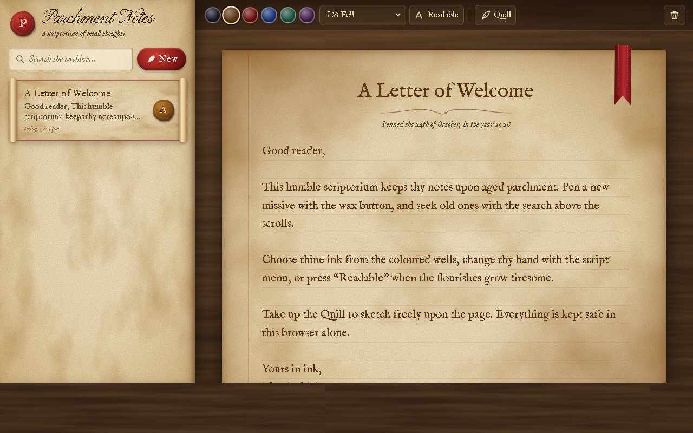

<p align="center"></p>

<p align="center">    </p>

A notes app that looks like handwriting on aged parchment. Notes are kept as rolled scrolls, written in calligraphy fonts with a choice of ink, sealed with wax and decorated with ribbons. There is even a quill mode for freehand drawing.

<p align="center"></p>

## Features

- Parchment and wood-grain textures generated from SVG noise (no image files)
- Calligraphy fonts (IM Fell, Pinyon Script, Homemade Apple, Tangerine) with a "Readable" toggle
- Six ink colours per note, each with a matching wax seal
- Page-turn, ink-reveal, seal-stamp and "burn on delete" animations
- Search with highlighted matches and automatic saving
- Quill mode: pressure- and speed-sensitive slanted-nib drawing saved as vector strokes, with undo
- Two-screen layout on phones

## Getting started

No build step and no dependencies. Clone the repo and open `index.html`, or serve the folder locally:

```bash
git clone https://github.com/Squidly1408/parchment-notes.git
cd parchment-notes
python -m http.server 5517
```

Then visit http://localhost:5517.

## Project structure

| File | Purpose |
|---|---|
| `index.html` | App shell |
| `app.js` | Notes, search, animations and quill drawing |
| `styles.css` | Parchment styling |
| `assets/` | Logo and README images |

## Built with

HTML, CSS, JavaScript (Canvas, SVG filters), localStorage

## Limitations

- Notes live in this browser only, with no export yet
- Drawings stay fixed to the page, so they can drift if text reflows
- In quill mode a finger draws rather than scrolls on phones
- Fonts need an internet connection (falls back to Georgia)

## License

Released under the [MIT License](LICENSE).
